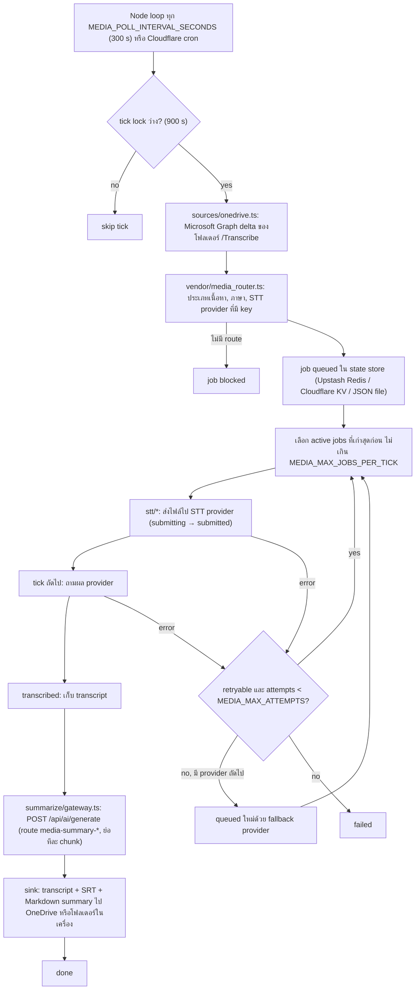

# 01 — Business process (As-Is / To-Be)

content-media-worker คือ worker ส่วนตัวของ owner ที่ดึงไฟล์ประชุม/วิดีโอจากโฟลเดอร์ OneDrive (หรือ URL) ไปถอดเสียงด้วย STT provider ที่เลือกตามภาษา แล้วสรุปภาษาไทยผ่าน AI gateway ของ owner และเขียน transcript, SRT, summary กลับข้างไฟล์ รันบน Node (loop) หรือ Cloudflare Workers (cron) แต่ยังไม่ deploy

Last reviewed: 2026-11-28 · commit `c213e04`

## As-Is (จากโค้ดวันนี้)

Sources: `core/pipeline.ts` (`runTick`, `buildOutputs`), `entry/node.ts` (`once`, `loop`, `login`, `transcribe`, `eval`), `entry/cloudflare.ts` (`scheduled`, `fetch` = health only), `sources/onedrive.ts`, `state/kv.ts`, `stt/index.ts`, `summarize/gateway.ts`, `vendor/media_router.ts`, `PRODUCT.md`

ข้อเท็จจริงสำคัญจากโค้ด:

- ไม่มีทางเข้าจากภายนอก: Cloudflare `fetch` ตอบ `{"status":"ok"}` อย่างเดียว, Node ไม่มี HTTP server (`test/entry.test.ts`)
- Cloudflare entry ไม่มี Sentry; Node ส่ง error ผ่าน allowlist ใน `core/sentry.ts` เมื่อมี `SENTRY_DSN`
- ไม่มี `wrangler.toml` (มีแค่ `.example`), ไม่มี deploy workflow และไม่มี live URL; registry ระบุเป็น local only
- `vendor/` เป็นสำเนา router/registry จาก solo-empire ซึ่ง archive แล้ว (2026-11-13) ต้นฉบับปัจจุบัน [ต้องยืนยัน]

## To-Be (ไม่มี To-Be ที่เขียนไว้)

ไม่มี To-Be ที่เขียนไว้ มีเพียงขั้นต่อไปและ gap ที่ระบุใน `DOCPACK/00-product-card.md` §8 และ `PRODUCT.md` §AI / §Limits (ดูตาราง Gap) ซึ่งไม่ได้กำหนดกระบวนการเป้าหมาย

## Gap

| ID | As-Is → To-Be | Status | Owner | Evidence |
|---|---|---|---|---|
| G1 | ไม่มี To-Be ของกระบวนการ (deploy target, runtime ที่เลือก) → owner กำหนด | decide | owner | ไม่มีใน `PRODUCT.md` / `DOCPACK/`; registry `media-worker` = local only |
| G2 | ยังไม่เคยถอดเสียงไฟล์จริงแบบ end to end → ทดสอบตัวอย่างจริงหนึ่งไฟล์ | todo | owner | `DOCPACK/00-product-card.md` §8; `PRODUCT.md` status 2026-10-22 |
| G3 | `own_eval` ว่างทุก provider และไม่มี reference set → commit reference set และกำหนด threshold | todo | claude | `PRODUCT.md` §AI Eval status |
| G4 | ไม่มี spend cap ใน repo นอกจาก token budget ต่อ call และ job cap ต่อ tick → owner ตัดสินเรื่อง budget | decide | owner | `PRODUCT.md` §AI |
| G5 | `vendor/` เป็นสำเนาที่อาจ drift จากต้นฉบับ → ระบุต้นฉบับที่ใช้ sync | todo | claude | `README.md`; `PRODUCT.md` §Limits |
| G6 | ไม่มี CI ตาม product card → shared CI ทุก push | done | claude | `.github/workflows/ci.yml` |

## Open questions

- จะ deploy บน Cloudflare Workers, container หรือคงเป็น local tool (verdict `showcase`)
- routing contract ต้นฉบับย้ายจาก solo-empire ไปอยู่ repo ไหน [ต้องยืนยัน]
